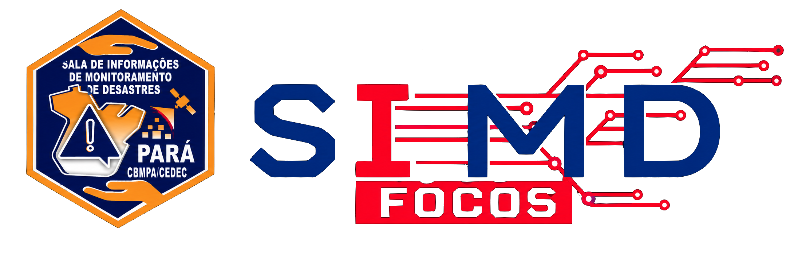

<p align="center">
  
</p>

# AutoSIMD-FOCOS

**Diagnóstico Territorial de Focos de Calor**
Sala de Informações e Monitoramento de Desastres (SIMD) — Coordenadoria Estadual de Proteção e Defesa Civil do Pará (CEDEC/PA)

O AutoSIMD-FOCOS automatiza a análise histórica de focos de calor detectados por satélite (BDQueimadas/INPE) e gera, em poucos segundos, um diagnóstico territorial pronto para apoiar o planejamento de prevenção e combate a incêndios florestais.

Situação: **v0.11 (22/10/2026)** — reorganização do v0.10 (arquivo único) no modelo do AutoSIMD-DESASTRE, com Panorama do Estado, estatísticas no modelo do Programa Queimadas/INPE, nowcast e base atualizada em segundo plano pelo INPE. Testes: `python -m pytest`.

> [!IMPORTANT]
> **Desenvolvido com Inteligência Artificial.** Todo o código deste programa foi desenvolvido com a utilização de ferramentas de Inteligência Artificial, com acompanhamento, revisão e testes realizados pelos técnicos de Defesa Civil da CEDEC/PA. Os resultados são produzidos automaticamente a partir de bases públicas oficiais e devem ser interpretados por profissionais habilitados. A identidade visual (logo do AutoSIMD-FOCOS) também foi gerada com IA (ChatGPT).

## O que o programa faz

Você escolhe **o território** e **o período de anos**, clica em **Processar Diagnóstico Completo** e o sistema gera:

- **Resumo executivo** — focos no ano, posição no ranking nacional e estadual do ano, participação no total do estado, variação em relação ao ano anterior e **densidade média anual (focos/km²/ano)**.
- **Gráficos** — Top 5 municípios do estado, evolução anual dos focos e padrão sazonal (distribuição mensal).
- **Mapas** — densidade de kernel dos focos no último ano (com as UCs e TIs do município) e no período, recorrência em grade de 10 km × 10 km, migração sazonal por trimestre e o cenário atual sobre imagem de satélite.
- **Tabelas** — ranking estadual, comparativo na Região de Integração do Pará e focos por UC/TI no município.
- **Estatísticas no modelo do Programa Queimadas/INPE** (município, UC e TI) — focos mês a mês e dia a dia, comparativos mensal, semanal e por semestre com mínimo, média e máximo, e o acumulado mensal com faixa p10–p90, em gráficos interativos com parâmetros ajustáveis.
- **Cenário atual (nowcast)** — focos do último dia, dos últimos 7 e 30 dias e do ano no município, comparados com os mesmos dias dos anos anteriores, com mapa e lista dos focos recentes.
- **Panorama do Estado** (página inicial) — indicadores, mapa, municípios e estatísticas do estado, com filtro por região.
- **Base sempre atualizada, sem esperar** — o programa abre com a base local e busca os focos novos do INPE em segundo plano; com o **Nowcast** ligado, busca a cada 4 horas; quando o mês fecha, troca os dias diários pelo arquivo mensal consolidado.
- **Pacote para download (.zip)** com relatório **PDF**, planilha **Excel**, grade **GeoJSON** para o QGIS, **KML de risco de recorrência** (baixo, moderado, alto, muito alto), rankings em CSV e todas as imagens em PNG.

| Nível | Exemplo |
|---|---|
| Estado / Município (qualquer município do Brasil) | São Félix do Xingu – PA |
| Unidade de Conservação (UC) | Estação Ecológica da Terra do Meio |
| Terra Indígena (TI) | TI Apyterewa |

## Download oficial

> [!WARNING]
> Baixe o AutoSIMD-FOCOS **somente** pela página oficial do projeto no GitHub:
> **https://github.com/engamblobs/Autosimd-Focos/releases**
>
> Não utilize cópias recebidas por e-mail, WhatsApp, pen drive ou outros sites. Arquivos de outras origens podem estar desatualizados ou ter sido modificados e conter vírus. Em caso de dúvida, confirme com a SIMD/CEDEC-PA antes de executar.

Na página de Releases, a versão mais recente aparece no topo com a etiqueta **Latest**. Em **Assets**, clique no arquivo `AutoSIMD-FOCOS_v<versão>.zip` para baixar. Os arquivos *Source code (zip)* e *Source code (tar.gz)* contêm apenas o código-fonte, sem as bases de dados, e **não servem para instalar** o programa.

## Instalação no Windows

Não é preciso instalar Python: o pacote já traz tudo.

**Requisitos:** Windows 10 ou 11 (64 bits) e cerca de 2 GB livres em disco. Internet só para buscar os focos novos do INPE e para a imagem de satélite do cenário atual — sem ela, o sistema funciona com a base que já tem.

1. Baixe o arquivo `AutoSIMD-FOCOS_v<versão>.zip` (≈ 325 MB) na **[página oficial de Releases](https://github.com/engamblobs/Autosimd-Focos/releases/latest)**, conforme a seção [Download oficial](#download-oficial).
2. Clique com o botão direito no arquivo baixado → **Extrair tudo…** e escolha uma pasta sua (ex.: `C:\AutoSIMD-FOCOS`). **Não execute de dentro do .zip** — extraia primeiro. Evite "Arquivos de Programas": o sistema precisa gravar a base atualizada na própria pasta.
3. Abra a pasta extraída e dê dois cliques em **`Iniciar_AutoSIMD-FOCOS.bat`**.
4. Se o Windows exibir *"O Windows protegeu o computador"*, clique em **Mais informações → Executar assim mesmo**.
5. Uma janela preta abre e, em alguns segundos, o sistema aparece no navegador (endereço `http://127.0.0.1:8521`; se essa porta estiver em uso, o sistema usa a próxima livre — 8522, 8523…). Pode ser usado ao mesmo tempo que outros sistemas da SIMD.
6. Na primeira execução é criado o atalho **AutoSIMD-FOCOS** na Área de Trabalho — use-o nas próximas vezes.

**Focos novos:** o sistema abre com a base que já tem e busca os focos novos do INPE em segundo plano. Ligue o **Nowcast** na barra lateral para buscar na hora e depois a cada 4 horas.

**Para encerrar:** feche a janela preta. Fechar apenas o navegador deixa o sistema rodando.

**Para atualizar o programa:** baixe o `.zip` da nova versão na página oficial, extraia em uma nova pasta e abra o `.bat` dela uma vez — o atalho da Área de Trabalho passa a apontar para a versão nova.

## Para desenvolvedores

```bash
python run_app.py                      # abre no navegador (porta 8521, ou a próxima livre até 8570)
python -m streamlit run app.py         # modo desenvolvimento
python -m pytest                       # testes (usam o recorte real de amostras/bases; nunca acessam a internet)
python empacotamento/empacotar_windows.py      # gera dist/AutoSIMD-FOCOS_v<versão>/ e o .zip
```

No ambiente de desenvolvimento, use `/home/lobs/.local/share/venvs/fortracc2-env/bin/python3.14`. As bases completas não ficam no repositório (≈770 MB); coloque-as em `BASES_GEOJSON/` (`docs/03`). Regras de desenvolvimento em `CLAUDE.md`.

## Fontes de dados

- **Focos de calor:** BDQueimadas / INPE (satélite de referência).
- **Limites municipais:** IBGE · **Unidades de Conservação:** CNUC / MMA · **Terras Indígenas:** FUNAI.
- **Regiões:** Regiões de Integração do Pará; Regiões Geográficas Imediatas do IBGE (2017).
- **Imagem de satélite (cenário atual):** Sentinel-2 cloudless 2024 (s2maps.eu), EOX IT Services GmbH — CC BY-NC-SA 4.0.

## Documentação

- `CLAUDE.md` — regras para o desenvolvimento assistido por IA
- `docs/01` a `docs/10` — definição, telas, fontes, arquitetura e pastas, dados, regras, roadmap, pendências e produtos
- `amostras/bases/` — recorte real das bases usado nos testes

## Autor e contato

**Bruno Lobão da Silva** — Técnico de Defesa Civil, CEDEC/PA (DGR/SIMD) · Soldado do CBMPA
📧 engamb.lobs@gmail.com · Sala de Monitoramento: simdcedec@gmail.com
