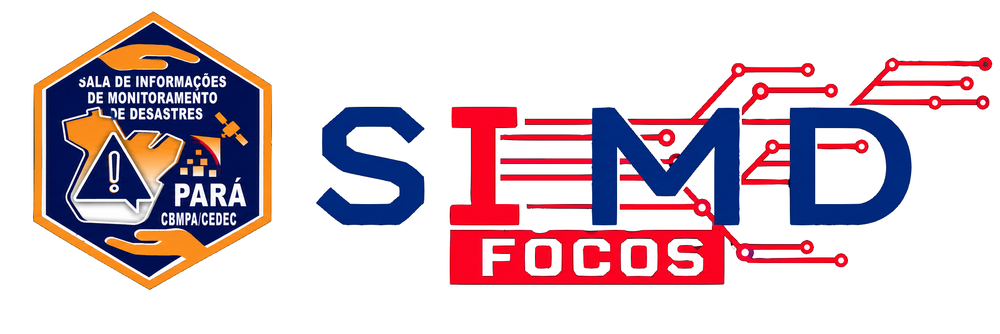
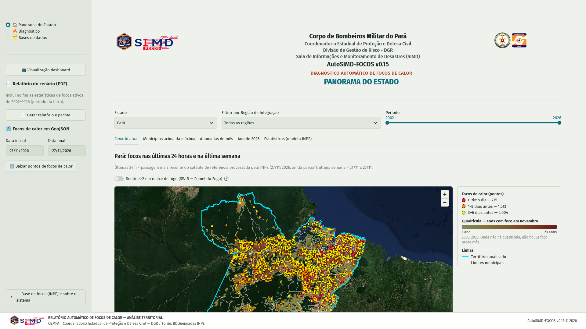
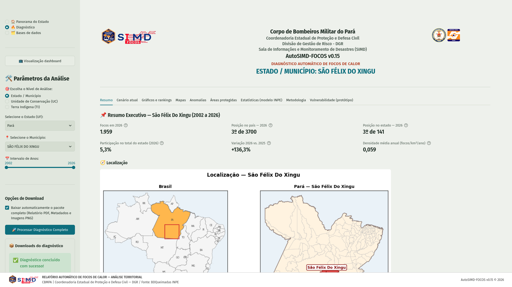
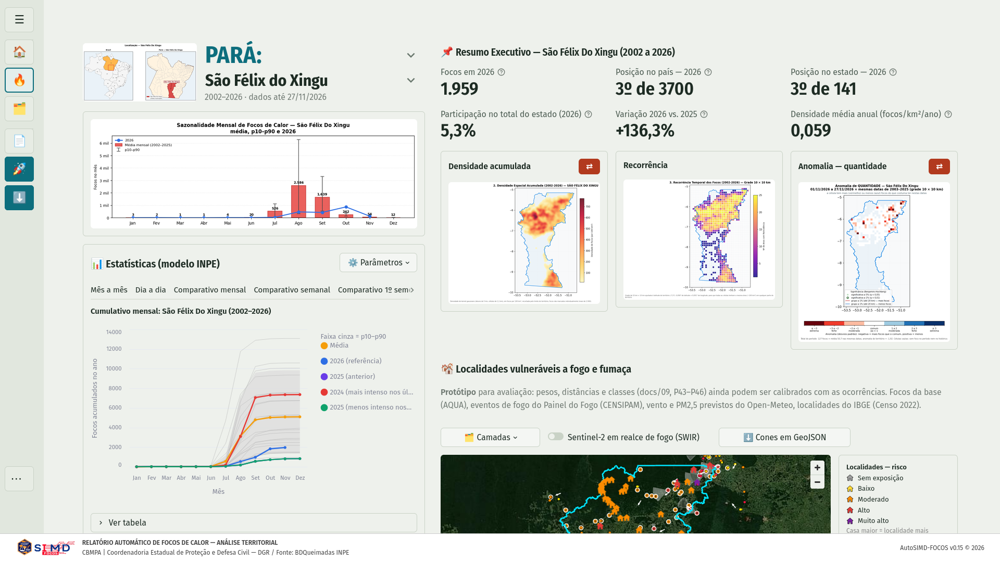
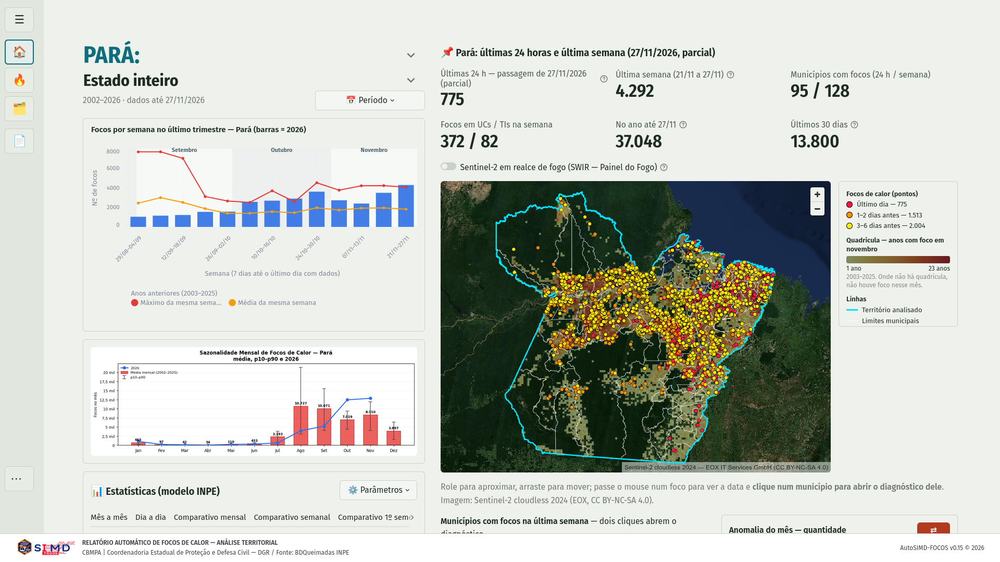
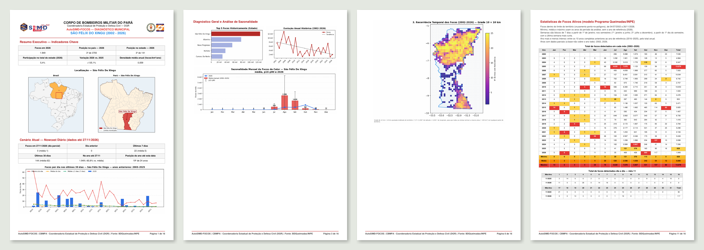
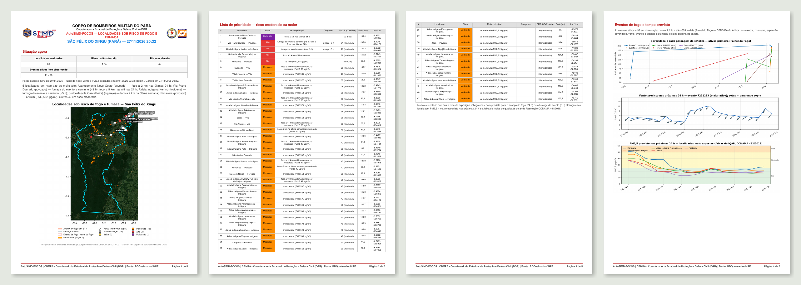

<p align="center">
  
</p>

# AutoSIMD-FOCOS

**Diagnóstico Territorial de Focos de Calor**
Sala de Informações e Monitoramento de Desastres (SIMD) — Coordenadoria Estadual de Proteção e Defesa Civil do Pará (CEDEC/PA)

O AutoSIMD-FOCOS automatiza a análise histórica de focos de calor detectados por satélite (BDQueimadas/INPE) e gera, em poucos segundos, um diagnóstico territorial pronto para apoiar o planejamento de prevenção e combate a incêndios florestais.

Situação: **v0.15 (27/11/2026)** — modo dashboard para TV (Panorama do Estado e diagnóstico de município), localidades vulneráveis a fogo e fumaça com boletim em PDF, e o diagnóstico em PDF resumido e completo. A v0.14 trouxe a interface nova (tema próprio, páginas em abas, boletim do cenário); a v0.13 trouxe os mapas de anomalia e o mapa interativo; a v0.12, o cenário atual do estado; a v0.11 reorganizou o v0.10 no modelo do AutoSIMD-DESASTRE.

> [!IMPORTANT]
> **Desenvolvido com Inteligência Artificial.** Todo o código deste programa foi desenvolvido com a utilização de ferramentas de Inteligência Artificial, com acompanhamento, revisão e testes realizados pelos técnicos de Defesa Civil da CEDEC/PA. Os resultados são produzidos automaticamente a partir de bases públicas oficiais e devem ser interpretados por profissionais habilitados. A identidade visual (logo do AutoSIMD-FOCOS) também foi gerada com IA (ChatGPT).

## Prévia

Veja como é o programa antes de instalar (telas reais, com os dados de São Félix do Xingu – PA).

**Panorama do Estado** — página inicial: focos das últimas 24 horas e da última semana sobre imagem de satélite, com a recorrência do mês, indicadores e abas de municípios, anomalias e estatísticas.

<p align="center"></p>

**Diagnóstico de município** — escolha o território e o período no painel esquerdo; o resultado vem em abas (resumo, cenário atual, gráficos, mapas, anomalias, áreas protegidas, estatísticas, metodologia e localidades vulneráveis).

<p align="center"></p>

**Modo dashboard (para TV) — diagnóstico de município** — o diagnóstico inteiro numa tela, com letras grandes. O estado e o município são escolhidos no próprio título; o painel esquerdo fica recolhido só com os ícones; os botões ⇄ alternam os mapas do mesmo tipo; os focos, o vento e a fumaça são buscados sozinhos para o mapa das localidades vulneráveis; os downloads (PDF resumido, PDF completo e pacote) ficam numa caixa no próprio painel.

<p align="center"></p>

**Modo dashboard — Panorama do Estado** — o cenário do estado numa tela: estado e região no título, indicadores das últimas 24 horas e da semana, mapa interativo, focos por semana, sazonalidade, municípios da última semana, anomalia do mês, municípios acima da máxima e estatísticas.

<p align="center"></p>

**Relatório PDF do diagnóstico** — em duas versões: o **resumido** (os quatro mapas numa página) e o **completo** (tudo, com o boletim das localidades sob risco anexado). Vão no pacote .zip junto com a planilha Excel, os GeoJSON para o QGIS e todas as imagens em PNG.

<p align="center"></p>

**Boletim das localidades sob risco de fogo e fumaça (PDF)** — situação com mapa, lista de prioridade para o despacho das equipes (motivo, hora prevista de chegada do fogo ou da fumaça, qualidade do ar pela CONAMA 491/2018 e coordenadas), eventos de fogo e previsão do tempo, e o método.

<p align="center"></p>

## O que o programa faz

Você escolhe **o território** e **o período de anos**, clica em **Processar Diagnóstico Completo** e o sistema gera:

- **Resumo executivo** — focos no ano, posição no ranking nacional e estadual do ano, participação no total do estado, variação em relação ao ano anterior e **densidade média anual (focos/km²/ano)**.
- **Gráficos** — Top 5 municípios do estado, evolução anual dos focos e padrão sazonal (distribuição mensal).
- **Mapas** — densidade de kernel dos focos no último ano (com as UCs e TIs do município) e no período, recorrência em grade proporcional ao território (10 km a 1,25 km), migração sazonal por trimestre e o cenário atual sobre imagem de satélite. Mapa de localização (Brasil → estado → território) e **mapas de anomalia** (mais ou menos focos que o comum nas mesmas datas, em quantidade e localização, com as células estatisticamente significativas marcadas).
- **Tabelas** — ranking estadual, comparativo na Região de Integração do Pará e focos por UC/TI no município.
- **Estatísticas no modelo do Programa Queimadas/INPE** (município, UC e TI) — focos mês a mês e dia a dia, comparativos mensal, semanal e por semestre com mínimo, média e máximo, e o acumulado mensal com faixa p10–p90, em gráficos interativos com parâmetros ajustáveis.
- **Cenário atual (nowcast)** — focos do último dia, dos últimos 7 e 30 dias e do ano no município, comparados com os mesmos dias dos anos anteriores, com mapa e lista dos focos recentes.
- **Panorama do Estado** (página inicial) — indicadores, mapa, municípios e estatísticas do estado, com filtro por região.
  Abre com o **cenário atual**: focos das últimas 24 h (passagem mais recente do satélite de referência) e da última semana, com mapa, municípios, UCs/TIs e o **PDF do cenário** para exportar.
- **Base sempre atualizada, sem esperar** — o programa abre com a base local e busca os focos novos do INPE em segundo plano; com o **Nowcast** ligado, busca a cada 4 horas; quando o mês fecha, troca os dias diários pelo arquivo mensal consolidado.
- **Pacote para download (.zip)** com relatório **PDF**, planilha **Excel**, grade **GeoJSON** para o QGIS, **KML de risco de recorrência** (baixo, moderado, alto, muito alto), rankings em CSV e todas as imagens em PNG.

| Nível | Exemplo |
|---|---|
| Estado / Município (qualquer município do Brasil) | São Félix do Xingu – PA |
| Unidade de Conservação (UC) | Estação Ecológica da Terra do Meio |
| Terra Indígena (TI) | TI Apyterewa |

## Roadmap

Versões publicadas (detalhes em [Releases](https://github.com/engamblobs/Autosimd-Focos/releases)):

| Versão | Data | Destaques |
|---|---|---|
| v0.15 | 27/11/2026 | Modo dashboard (para TV) no Panorama do Estado e no diagnóstico de município; localidades vulneráveis a fogo e fumaça (Painel do Fogo, vento e PM2,5) com boletim em PDF; PDF resumido e completo |
| v0.14 | 23/11/2026 | Interface nova: tema próprio, páginas em abas, boletim do cenário atual |
| v0.13 | 29/10/2026 | Mapas de anomalia, mapa interativo e de localização, recordes |
| v0.12 | 29/10/2026 | Cenário atual do estado e PDF do cenário |
| v0.11 | 22/10/2026 | Reorganização em módulos, Panorama do Estado, estatísticas no modelo INPE e nowcast |

**Planos futuros:**

- [ ] **Dashboard otimizado para televisões** — telas de sala de situação: leitura a distância, tudo numa tela sem rolagem, atualização automática.
- [ ] **Dashboard para Unidades de Conservação e Terras Indígenas** — o mesmo painel único que hoje existe para os municípios.
- [ ] **Interface para celular (modo mobile)** — layout que se adapta a telas pequenas, para uso em campo.
- [ ] **Hospedagem do site** — acesso pelo navegador, sem instalar o programa.
- [ ] **Publicação científica do projeto** — método, validação e resultados em periódico.
- [ ] **Integração com o MapBiomas Fogo via API** — áreas queimadas mapeadas pelo MapBiomas ao lado dos focos de calor.

## Download oficial

> [!WARNING]
> Baixe o AutoSIMD-FOCOS **somente** pela página oficial do projeto no GitHub:
> **https://github.com/engamblobs/Autosimd-Focos/releases**
>
> Não utilize cópias recebidas por e-mail, WhatsApp, pen drive ou outros sites. Arquivos de outras origens podem estar desatualizados ou ter sido modificados e conter vírus. Em caso de dúvida, confirme com a SIMD/CEDEC-PA antes de executar.

Na página de Releases, a versão mais recente aparece no topo com a etiqueta **Latest**. Em **Assets**, clique no arquivo `AutoSIMD-FOCOS_v<versão>.zip` para baixar. Os arquivos *Source code (zip)* e *Source code (tar.gz)* contêm apenas o código-fonte, sem as bases de dados, e **não servem para instalar** o programa.

### Conferir o arquivo baixado

Cada Release mostra o código **SHA256** do `.zip` (no texto da versão e ao lado do arquivo, em *Assets*). Antes de extrair, abra o PowerShell na pasta onde está o arquivo e digite:

```powershell
Get-FileHash .\AutoSIMD-FOCOS_v<versão>.zip
```

O código da coluna **Hash** tem que ser **igual** ao publicado (maiúsculas ou minúsculas não importam). Se for diferente, não use o arquivo: apague-o e avise a SIMD/CEDEC-PA.

## Instalação no Windows

Não é preciso instalar Python: o pacote já traz tudo.

**Requisitos:** Windows 10 ou 11 (64 bits) e cerca de 2 GB livres em disco. Internet só para buscar os focos novos do INPE e para a imagem de satélite do cenário atual — sem ela, o sistema funciona com a base que já tem.

1. Baixe o arquivo `AutoSIMD-FOCOS_v<versão>.zip` (≈ 325 MB) na **[página oficial de Releases](https://github.com/engamblobs/Autosimd-Focos/releases/latest)**, conforme a seção [Download oficial](#download-oficial), e [confira o SHA256](#conferir-o-arquivo-baixado).
2. Clique com o botão direito no arquivo baixado → **Extrair tudo…** e escolha uma pasta sua (ex.: `C:\AutoSIMD-FOCOS`). **Não execute de dentro do .zip** — extraia primeiro. Evite "Arquivos de Programas": o sistema precisa gravar a base atualizada na própria pasta.
3. Abra a pasta extraída e dê dois cliques em **`Iniciar_AutoSIMD-FOCOS.bat`**.
4. Se o Windows exibir *"O Windows protegeu o computador"* e o SHA256 do .zip conferiu, clique em **Mais informações → Executar assim mesmo**.
5. Uma janela preta abre e, em alguns segundos, o sistema aparece no navegador (endereço `http://127.0.0.1:8521`; se essa porta estiver em uso, o sistema usa a próxima livre — 8522, 8523…). Pode ser usado ao mesmo tempo que outros sistemas da SIMD.
6. Na primeira execução é criado o atalho **AutoSIMD-FOCOS v<versão>** na Área de Trabalho — use-o nas próximas vezes.

**Focos novos:** o sistema abre com a base que já tem e busca os focos novos do INPE em segundo plano. Ligue o **Nowcast** na barra lateral para buscar na hora e depois a cada 4 horas.

**Para encerrar:** feche a janela preta. Fechar apenas o navegador deixa o sistema rodando.

**Para atualizar o programa:** baixe o `.zip` da nova versão na página oficial, extraia em uma nova pasta e abra o `.bat` dela uma vez — ela cria o seu próprio atalho (com o número da versão) na Área de Trabalho; o da versão anterior pode ser apagado.

## Para desenvolvedores

```bash
python run_app.py                      # abre no navegador (porta 8521, ou a próxima livre até 8570)
python -m streamlit run app.py         # modo desenvolvimento
python -m pytest                       # testes (usam o recorte real de amostras/bases; nunca acessam a internet)
python empacotamento/empacotar_windows.py      # gera dist/AutoSIMD-FOCOS_v<versão>/ e o .zip
```

No ambiente de desenvolvimento, use `/home/lobs/.local/share/venvs/fortracc2-env/bin/python3.14`. As bases completas não ficam no repositório (≈770 MB); coloque-as em `BASES_GEOJSON/` (`docs/03`). Regras de desenvolvimento em `CLAUDE.md`.

## Fontes de dados

- **Focos de calor:** BDQueimadas / INPE (satélite de referência).
- **Limites municipais:** IBGE · **Unidades de Conservação:** CNUC / MMA · **Terras Indígenas:** FUNAI.
- **Regiões:** Regiões de Integração do Pará; Regiões Geográficas Imediatas do IBGE (2017).
- **Imagem de satélite (cenário atual):** Sentinel-2 cloudless 2024 (s2maps.eu), EOX IT Services GmbH — CC BY-NC-SA 4.0.

## Documentação

- `CLAUDE.md` — regras para o desenvolvimento assistido por IA
- `docs/01` a `docs/10` — definição, telas, fontes, arquitetura e pastas, dados, regras, roadmap, pendências e produtos
- `amostras/bases/` — recorte real das bases usado nos testes

## Autor e contato

**Bruno Lobão da Silva** — Técnico de Defesa Civil, CEDEC/PA (DGR/SIMD) · Soldado do CBMPA
📧 engamb.lobs@gmail.com · Sala de Monitoramento: simdcedec@gmail.com
